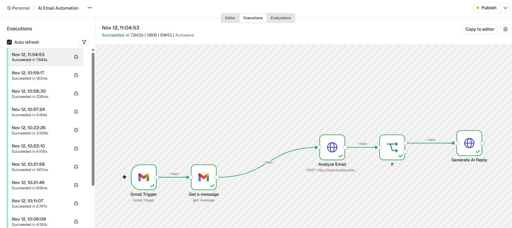
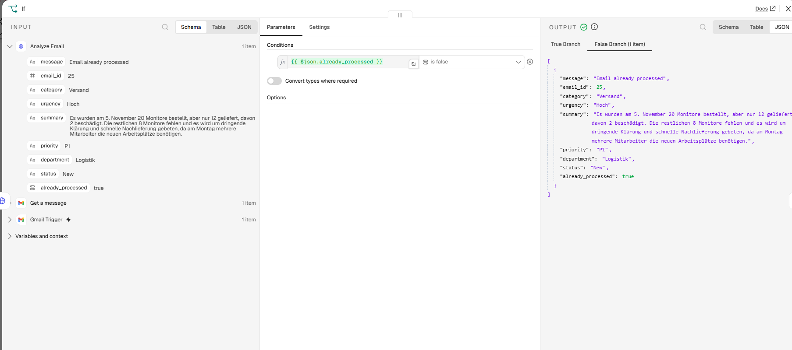
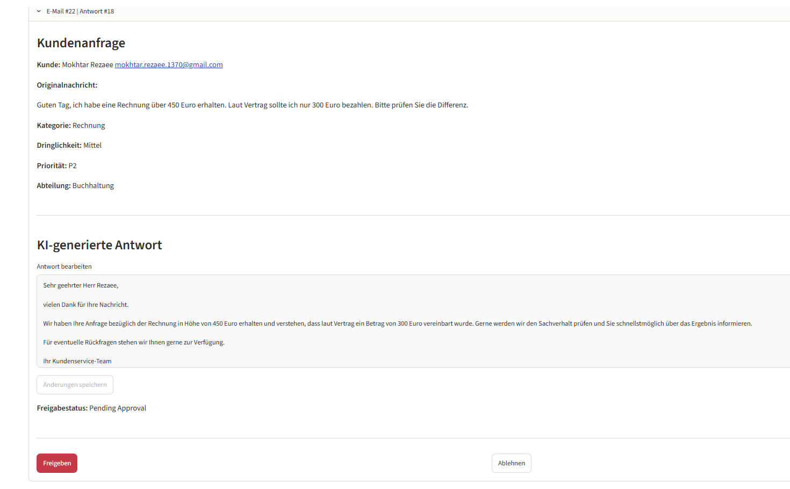
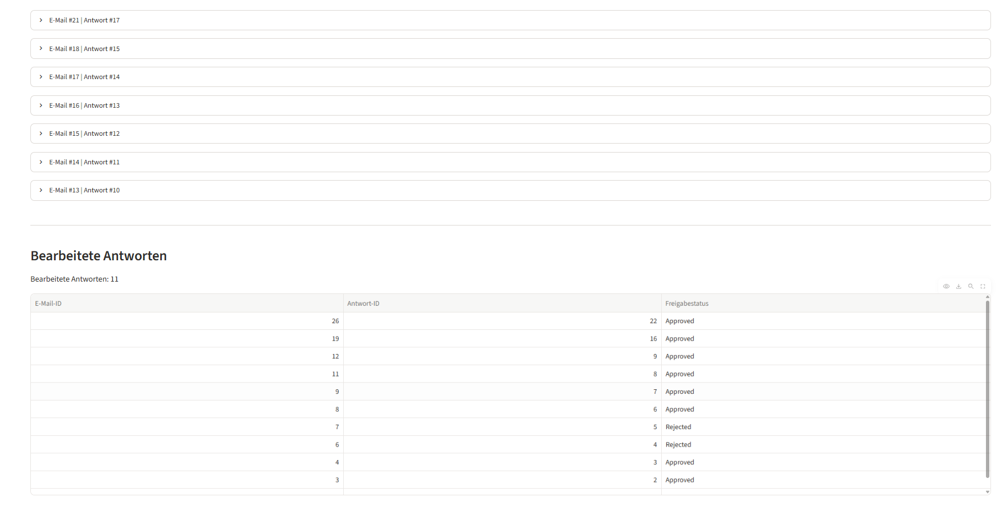

# AI Email Automation

**AI-Powered Email Classification, Workflow Automation and Human-in-the-Loop Approval**

An AI-powered email automation system that processes incoming Gmail messages, classifies customer requests, assigns priorities, generates response drafts and supports manual approval before sending.

The project combines **Python, FastAPI, OpenAI, SQLite, n8n, Gmail API and Streamlit**.

## Project Overview

The system automates the processing of incoming customer emails.

**Workflow:**

1. Gmail Trigger detects a new email.
2. Gmail API retrieves the email content.
3. FastAPI sends the email text to an OpenAI model for analysis.
4. The system determines the category, urgency, priority and responsible department.
5. SQLite stores the analysis and prevents duplicate processing using the Gmail message ID.
6. n8n generates an AI-powered response draft for new emails.
7. Streamlit displays the email and generated response.
8. A user can edit, approve or reject the response.

**Important:** Email approval is implemented. Automatic sending through Gmail is not yet implemented.

## Technology Stack

| Technology | Purpose |
|---|---|
| Python | Backend development |
| FastAPI | REST API |
| OpenAI API | Email classification and response generation |
| SQLite | Email and approval data storage |
| n8n | Workflow automation |
| Gmail API | Email integration |
| Streamlit | Interactive approval dashboard |
| Docker | Running n8n |
| Pytest | Automated testing |

## Workflow Automation

The n8n workflow connects Gmail with the Python backend and automates email processing.



## Duplicate Email Protection

The system checks Gmail message IDs to prevent repeated processing of the same email.

If an email has already been processed, the workflow skips response generation.



## Human-in-the-Loop Approval

Generated responses are displayed in the Streamlit dashboard.

Users can review, edit, approve or reject AI-generated drafts.



## Approval History

The dashboard separates pending approvals from processed responses.

Approved and rejected responses are stored in SQLite and displayed in the approval history.



## API Features

The FastAPI backend provides endpoints for:

- Analyzing and storing incoming emails
- Generating AI-powered response drafts
- Retrieving emails and generated responses
- Editing and updating response approval status
- Preventing duplicate email processing

Interactive API documentation is available locally at:

`http://localhost:8000/docs`

## Testing

The project includes automated tests for backend functionality.

Run the tests using:

```bash
python -m pytest -q
```

**Latest verified test result: 41 tests passed.**

## Current Project Status

**Implemented:**
- Gmail integration through n8n
- AI-powered email classification
- Priority assignment and department routing
- SQLite database integration
- Duplicate email detection
- AI-generated response drafts
- Manual approval and rejection
- Streamlit dashboard
- Automated backend tests

**Planned improvements:**
- Sending approved responses through Gmail
- Authentication and access control
- Additional monitoring and error handling
- Deployment and production configuration

## Project Purpose

This project demonstrates practical skills in AI integration, REST API development, business process automation, workflow orchestration and human-in-the-loop systems.